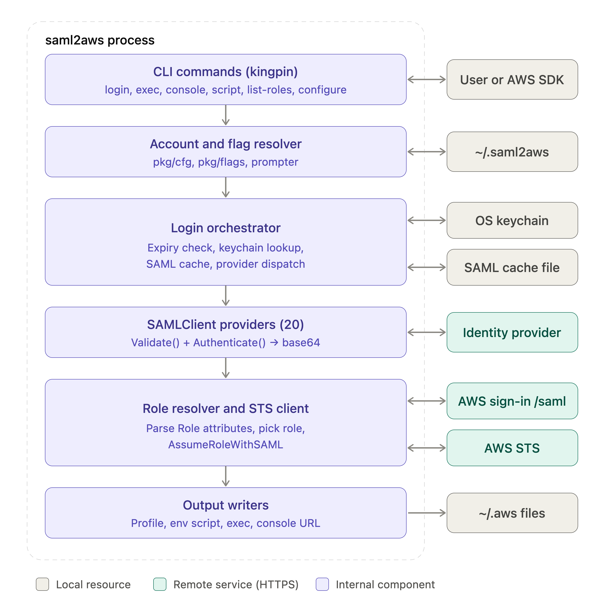
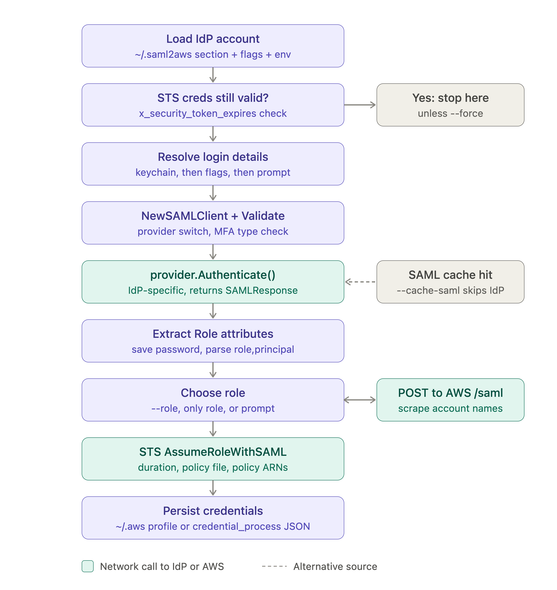
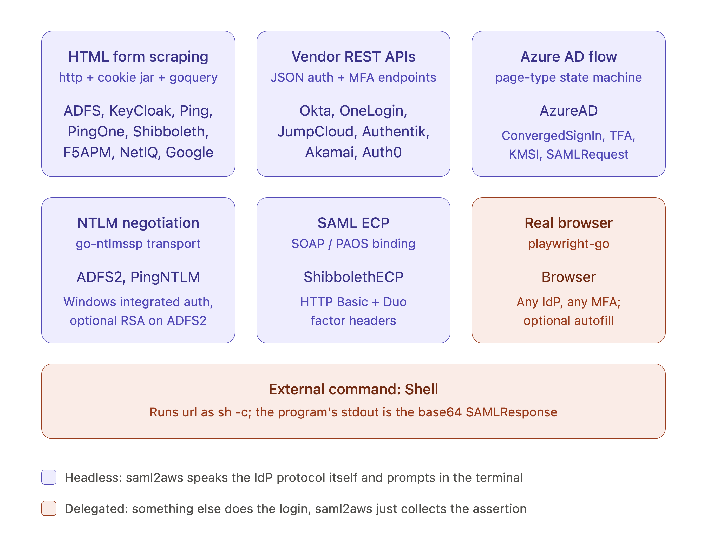
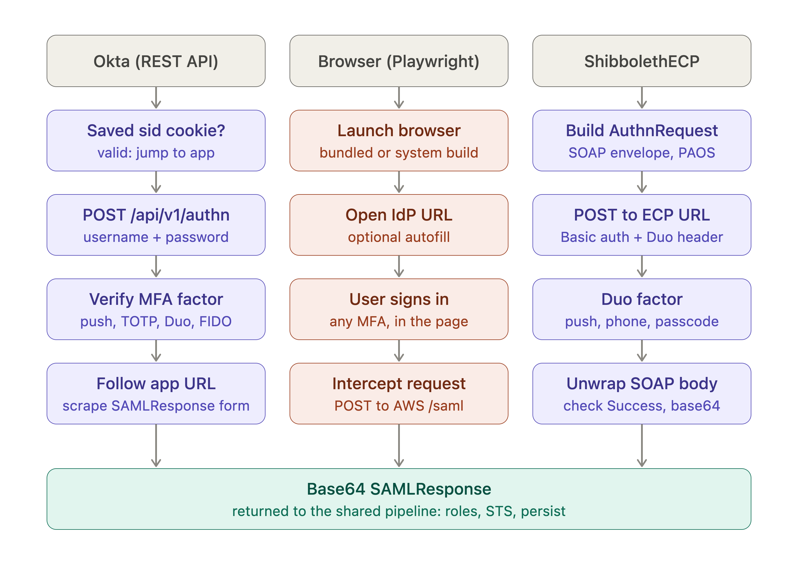

# saml2aws-sdkv2

An unofficial fork of [Versent/saml2aws](https://github.com/Versent/saml2aws) that replaces the end-of-support
AWS SDK for Go v1 with **[AWS SDK for Go v2](https://github.com/aws/aws-sdk-go-v2)** and builds with a current Go toolchain (**Go 1.27.3**, minimum **Go 1.26.10**).

Commands, identity providers, configuration files and flags are unchanged. If you already use saml2aws, this is a drop-in replacement. The few behaviour differences are listed [below](#behaviour-differences-from-upstream); please read them before you roll this out.

**Not affiliated with Versent.** This fork is maintained separately. Please report problems with this build
[here](https://github.com/stockmarkteam/saml2aws-sdkv2/issues), not on the upstream tracker.

## Table of Contents

- [saml2aws](#saml2aws)
  - [Table of Contents](#table-of-contents)
  - [Archirecture](#architecture)
  - [Login Pipeline](#login-pipeline)
  - [Auth Mechanism](#auth-mechanism)
  - [Auth Flows](#auth-flows)
  - [Requirements](#requirements)
  - [Caveats](#caveats)
  - [Install](#install)
    - [macOS](#macOS)
    - [Windows](#windows)
    - [Linux](#linux)
      - [Ubuntu](#ubuntu)
      - [Other](#other)
      - [Using Make](#using-make)
      - [Arch Linux and its derivatives](#arch-linux-and-its-derivatives)
      - [Void Linux](#void-linux)
  - [Autocomplete](#autocomplete)
    - [Bash](#bash)
    - [Zsh](#zsh)
  - [Dependency Setup](#dependency-setup)
  - [Usage](#usage)
    - [`saml2aws script`](#saml2aws-script)
    - [`saml2aws exec`](#saml2aws-exec)
    - [Configuring IDP Accounts](#configuring-idp-accounts)
  - [Example](#example)
  - [Advanced Configuration](#advanced-configuration)
    - [Windows Subsystem Linux (WSL) Configuration](#windows-subsystem-linux-wsl-configuration)
      - [Option 1: Disable Keychain](#option-1-disable-keychain)
      - [Option 2: Configure Pass to be the default keyring](#option-2-configure-pass-to-be-the-default-keyring)
    - [Configuring Multiple Accounts](#configuring-multiple-accounts)
      - [Dev Account Setup](#dev-account-setup)
      - [Test Account Setup](#test-account-setup)
  - [Advanced Configuration (Multiple AWS account access but SAML authenticate against a single 'SSO' AWS account)](#advanced-configuration-multiple-aws-account-access-but-saml-authenticate-against-a-single-sso-aws-account)
  - [Advanced Configuration - additional parameters](#advanced-configuration---additional-parameters)
  - [Building](#building)
    - [macOS](#macos)
    - [Linux](#linux-1)
  - [Environment vars](#environment-vars)
- [Dependencies](#dependencies)
- [Releasing](#releasing)
- [Debugging Issues with IDPs](#debugging-issues-with-idps)
- [Using saml2aws as credential process](#using-saml2aws-as-credential-process)
- [Caching the saml2aws SAML assertion for immediate reuse](#caching-the-saml2aws-saml-assertion-for-immediate-reuse)
- [Okta Sessions](#okta-sessions)
- [License](#license)

## Architecture
This diagram shows saml2aws as a single process (dashed boundary) made of six layers that a request passes through from top to bottom.



#### CLI commands
The kingpin command layer parses one of six commands: login, exec, console, script, list-roles and configure.
#### Account and flag resolver
 This layer (pkg/cfg, pkg/flags, prompter) merges the named IdP account from ~/.saml2aws with any command-line flags and SAML2AWS_* environment variables.
#### Login orchestrator
 It checks whether the current AWS credentials are still valid. If not, it looks up the saved password in the OS keychain, consults the optional SAML cache file, and hands off to an identity provider (IdP) implementation.
#### SAMLClient providers
 Twenty provider implementations sit behind a two-method interface, Validate() and Authenticate(). They are the only code that talks to the IdP, and each returns a base64-encoded SAML response.
 #### Role resolver and STS client
 This layer reads the AWS roles listed in the assertion. When there are several, it POSTs the assertion to the AWS sign-in /saml endpoint to get readable account names. It then calls STS AssumeRoleWithSAML.
####  Output writers
These deliver the temporary credentials in the form the command needs: a profile in ~/.aws/credentials, environment variables for a child process or an export script, or a federated console sign-in URL.

Color marks where each piece lives. Gray boxes are local resources on the user’s machine, teal boxes are remote services reached over HTTPS, and purple boxes are internal components. The key design point is that everything IdP-specific is confined to the provider layer; every other layer is shared by all providers.

## Login Pipeline
This diagram traces the login command, the path that turns an IdP sign-in into AWS credentials.



#### Load the IdP account
The account is loaded from ~/.saml2aws, with flags and environment variables applied on top.

#### Check existing credentials
If the stored credentials’ expiry (x_security_token_expires) hasn’t passed, the command stops early unless --force is given.

#### Resolve login details
Credentials come from the keychain first, then flags, then interactive prompts.

#### Build the provider
The provider is instantiated and validated, including whether the configured MFA type is allowed for it.

#### Authenticate
This is the one step that differs by provider. If --cache-saml is enabled and a cached assertion is still within its validity window, the cache is used instead and the IdP isn’t contacted (dashed arrow).

#### Extract roles
After a successful authentication the password is saved back to the keychain, and the AWS role/principal pairs are read from the assertion.

#### Choose a role
The role comes from --role, is selected automatically if there’s only one, or is picked from a prompt. When several roles exist, the assertion is POSTed to AWS’s sign-in page to get account names.

#### Assume the role
STS AssumeRoleWithSAML is called, honoring the session duration and any session policy.
Persist the credentials. They’re written either as a profile in ~/.aws/credentials or as credential_process JSON on stdout.

Teal steps make network calls to the IdP or AWS. Purple steps run locally.

Other commands reuse parts of this path. list-roles runs through role extraction and then prints the roles instead of calling STS. console runs the full pipeline when its credentials are missing, expired or rejected. exec runs it only when credentials look current but STS rejects them.


## Auth Mechanism
This diagram groups the 20 providers by how they obtain the SAML assertion. The technique, more than the vendor, determines a provider’s behavior, how fragile it is, and its security properties. Purple cards are headless: saml2aws speaks the IdP’s protocol itself and prompts for credentials and MFA in the terminal.



#### HTML form scraping
HTML form scraping (ADFS, KeyCloak, Ping, PingOne, Shibboleth, F5APM, NetIQ, GoogleApps) fetches login pages, parses forms with goquery, and posts them back using a cookie jar. These providers break when the IdP redesigns its login pages.

#### Vendor REST APIs
Vendor REST APIs (Okta, OneLogin, JumpCloud, Authentik, Akamai, Auth0) call the vendor’s JSON authentication and MFA endpoints. This is generally more stable than scraping.

#### The Azure AD flow
The Azure AD flow is a state machine. It reads the page-type configuration embedded in each Microsoft sign-in page and handles each step accordingly: credential entry, two-factor, “stay signed in” (KMSI), and posting the SAMLRequest.

####  NTLM negotiation
NTLM negotiation (ADFS2, PingNTLM) runs the NTLM handshake over HTTP using the typed username and password. The card’s “Windows integrated auth” label is misleading: these providers don’t use the logged-in Windows session, and they run on macOS and Linux too. Windows only matters on the server side. ADFS2 optionally adds an RSA SecurID step.

#### SAML ECP
SAML ECP (ShibbolethECP) uses SAML’s non-browser Enhanced Client or Proxy profile. It sends a SOAP AuthnRequest with HTTP Basic credentials and passes Duo factors in a request header.
Coral cards are delegated: something else performs the login and saml2aws only collects the assertion.

#### Real Browser
The Browser provider launches a real browser through Playwright. Because the user signs in in an actual browser, it works with any IdP and any MFA, including security keys with their origin binding intact.
The Shell provider runs a user-supplied executable and treats its stdout as the base64 SAML response. This makes it the extension point for IdPs saml2aws doesn’t support.


## Auth Flows
This diagram compares three providers that represent the main mechanisms, each shown as four steps in a column. All three end in the same place: a base64 SAMLResponse handed to the shared pipeline for role selection, STS and persistence.



#### Okta (REST API)
The Okta column is the API-driven headless flow.

 1. If a previous run left an Okta session cookie (sid) in the keychain and it’s still valid, the flow jumps straight to the app.
 2. Otherwise it POSTs the username and password to /api/v1/authn.
 3. It completes whichever MFA factor Okta requires, such as push, TOTP, Duo or FIDO.
 4. It uses the resulting session token to follow the AWS app’s embed URL, then scrapes the SAMLResponse from the auto-submit form Okta returns.

#### Browser (Playwright)
The Browser column is the delegated flow.

 1. saml2aws launches a Playwright-controlled browser, either a downloaded build or a configured system browser.
 2. It opens the IdP URL, optionally autofilling the username and password.
 3. The user signs in and completes MFA in the page.
 4. saml2aws intercepts the browser’s POST to the AWS SAML sign-in endpoint and reads the assertion from the request body. It never parses the IdP’s pages, which is why this provider survives IdP UI changes.


#### ShibbolethECP
The ShibbolethECP column is the standards-based non-browser flow.

 1. saml2aws builds a SOAP-wrapped AuthnRequest using the PAOS binding.
 2. It POSTs the request to the IdP’s ECP endpoint with HTTP Basic credentials and a Duo factor header.
 3. Duo push, phone call or passcode is completed out of band.
 4. saml2aws unwraps the SOAP response, checks that its status is Success, and base64-encodes the assertion.

The comparison shows the main trade-off. The headless Okta and ECP flows can run without a desktop browser but must understand the IdP’s protocol and MFA. The browser flow needs a GUI but works with any IdP and MFA.


## Requirements

* One of the supported Identity Providers
  * ADFS (2.x or 3.x)
  * [AzureAD](doc/provider/aad/README.md)
  * PingFederate + PingId
  * [Okta](pkg/provider/okta/README.md)
  * KeyCloak + (TOTP)
  * [Google Apps](pkg/provider/googleapps/README.md)
  * [Shibboleth](pkg/provider/shibboleth/README.md)
  * [F5APM](pkg/provider/f5apm/README.md)
  * [Akamai](pkg/provider/akamai/README.md)
  * OneLogin
  * NetIQ
  * Browser, this uses [playwright-go](github.com/playwright-community/playwright-go) to run a sandbox chromium window.
  * [Auth0](pkg/provider/auth0/README.md) NOTE: Currently, MFA not supported
  * [JumpCloud](doc/provider/jumpcloud/README.md)
* AWS SAML Provider configured


## What changed

Based on upstream `master` at [`65195ee`](https://github.com/Versent/saml2aws/commit/65195ee65d15) (after v2.36.19).

| Area | Upstream | This fork |
|---|---|---|
| AWS SDK | `github.com/aws/aws-sdk-go` v1.55.6 | `github.com/aws/aws-sdk-go-v2` v1.47 (`config`, `service/sts`, `credentials`) |
| Go | `go 1.21.0`, `toolchain go1.22.5` | `go 1.26.10`, `toolchain go1.27.3` |
| Lint | golangci-lint v1.55.2 | golangci-lint v2.15.0 (config migrated to the v2 format) |
| Build container | `Dockerfile.build`: `ubuntu:jammy` + Docker CLI, host Docker socket mounted, buildx | `golang:1.27.3-trixie` + GoReleaser 2.19.0, no socket or buildx; works with rootless Podman |

The code changes are limited to the STS calls in `cmd/saml2aws/commands/login.go` (`AssumeRoleWithSAML`) and
`cmd/saml2aws/commands/exec.go` (`GetCallerIdentity`, profile-based role assumption for `exec --exec-profile`).
There's also one `go vet` fix in the Shibboleth provider. Identity-provider code is untouched.

## Behaviour differences from upstream

### 1. STS endpoint: regional instead of global

| Region configured? | Upstream (SDK v1) | This fork (SDK v2) |
|---|---|---|
| No region anywhere | `https://sts.amazonaws.com` | `https://sts.amazonaws.com` (same) |
| A region, e.g. `ap-northeast-1` | `https://sts.amazonaws.com` for most regions\* | `https://sts.ap-northeast-1.amazonaws.com` |

\* SDK v1 used the global endpoint for `us-east-1` and the other long-standing regions unless you set `AWS_STS_REGIONAL_ENDPOINTS=regional`.

The region comes from, in order: `--region` / `SAML2AWS_REGION`, `region` in `~/.saml2aws`, `AWS_REGION` / `AWS_DEFAULT_REGION`,
and then `region` in the shared AWS config (`~/.aws/config`).

What this means for you:

- **Firewalls and proxies:** if outbound traffic is allow-listed, permit `sts.<region>.amazonaws.com` (or
  `sts.<region>.amazonaws.com.cn` in China regions) as well as `sts.amazonaws.com`. This is the most likely cause
  of a working upstream setup failing with this fork.
- **STS must be active in that region.** It is by default, but an administrator can deactivate a regional STS
  endpoint in IAM account settings.
- **SigV4A works out of the box.** The upstream caveat about setting `AWS_STS_REGIONAL_ENDPOINTS=regional` no longer
  applies. SDK v2 ignores that variable.
- To keep using the global endpoint, leave the region unset everywhere in the list above.

### 2. `exec --exec-profile` always reads `~/.aws/config`

SDK v1 only loaded the shared config file when `AWS_SDK_LOAD_CONFIG` was set. SDK v2 always loads it, so
`role_arn` / `source_profile` chains work without that variable.

### 3. Errors while checking existing credentials

`saml2aws exec` checks the saved credentials with `GetCallerIdentity`. If they have expired, or the profile hasn't been
created yet, it logs in again, the same as upstream. Other credential errors (for example a malformed
`~/.aws/config`) are now reported instead of silently starting a new login.

### 4. Go 1.26 TLS defaults

Building with a current Go version turns on its stricter TLS defaults: TLS 1.2 minimum, no RSA key exchange and no 3DES.
Modern identity providers aren't affected. If an old on-premises ADFS or Shibboleth server stops working, rebuild with a `godebug` block in `go.mod`, for example:

```
godebug (
	tls10server=1
	tlsrsakex=1
)
```

Unchanged: `--session-duration` still overrides `duration_seconds` in an AWS profile, and the credentials file,
`~/.saml2aws` and the keychain/credential-store entries keep the same names and format.

## Install

Pre-built binaries are attached to each [release](https://github.com/stockmarkteam/saml2aws-sdkv2/releases):

| File | Platform |
|---|---|
| `saml2aws_<version>_linux_amd64.tar.gz` | Linux x86-64 (static) |
| `saml2aws_<version>_linux_arm64.tar.gz` | Linux ARM64 (static) |
| `saml2aws_<version>_windows_amd64.zip` | Windows x64 |
| `saml2aws_<version>_windows_arm64.zip` | Windows ARM64 |
| `saml2aws-<version>-src.tar.gz` | Source |
| `SHA256SUMS` | Checksums for all of the above |

These binaries are built without cgo, the same way as upstream's static Linux and Windows builds. They **don't support USB security keys (U2F/FIDO via HID)**. If you need one, [build from source](#build-from-source) with
`CGO_ENABLED=1`.

There's no macOS binary: macOS Keychain support needs cgo, so it can't be cross-compiled. Build it on a Mac (see below).

### Linux

```sh
VERSION=2.36.19-sdkv2.1
curl -LO https://github.com/stockmarkteam/saml2aws-sdkv2/releases/download/v${VERSION}/saml2aws_${VERSION}_linux_amd64.tar.gz
curl -LO https://github.com/stockmarkteam/saml2aws-sdkv2/releases/download/v${VERSION}/SHA256SUMS
sha256sum --ignore-missing -c SHA256SUMS
tar -xzf saml2aws_${VERSION}_linux_amd64.tar.gz saml2aws
sudo install -m 0755 saml2aws /usr/local/bin/saml2aws
saml2aws --version
```

### Windows (PowerShell)

```powershell
$Version = "2.36.19-sdkv2.1"
Invoke-WebRequest "https://github.com/stockmarkteam/saml2aws-sdkv2/releases/download/v$Version/saml2aws_${Version}_windows_amd64.zip" -OutFile saml2aws.zip
(Get-FileHash saml2aws.zip -Algorithm SHA256).Hash   # compare with SHA256SUMS
Expand-Archive saml2aws.zip -DestinationPath "$env:LOCALAPPDATA\saml2aws"
# add %LOCALAPPDATA%\saml2aws to your PATH
```

### Replacing an existing upstream install

Remove or unlink the upstream binary first so the right one is on your `PATH`
(`brew uninstall saml2aws`, `choco uninstall saml2aws`, or delete the old binary). Your existing configuration and
saved credentials keep working.

## Build from source

Requirements:

- Go **1.26.10 or newer**. `go.mod` also sets `toolchain go1.27.3`, so with the default `GOTOOLCHAIN=auto` an older 1.26.x
  will download Go 1.27.3 before building. On offline or air-gapped machines, set `GOTOOLCHAIN=local` to build with
  the installed Go (1.26.10 or newer).
- For cgo builds on Debian/Ubuntu: `sudo apt install build-essential libudev-dev`.

```sh
tar -xzf saml2aws-2.36.19-sdkv2.1-src.tar.gz && cd saml2aws   # or: git clone https://github.com/stockmarkteam/saml2aws-sdkv2 && cd saml2aws-sdkv2
VERSION=2.36.19-sdkv2.1

# Linux / Windows, static (no USB security keys)
CGO_ENABLED=0 go build -trimpath -ldflags "-s -w -X main.Version=${VERSION}" -o saml2aws ./cmd/saml2aws

# Linux with USB security-key support
CGO_ENABLED=1 go build -trimpath -tags hidraw -ldflags "-s -w -X main.Version=${VERSION}" -o saml2aws ./cmd/saml2aws

# macOS (Keychain support needs cgo, and Xcode command-line tools)
CGO_ENABLED=1 go build -trimpath -ldflags "-s -w -X main.Version=${VERSION}" -o saml2aws ./cmd/saml2aws
```

Without `-X main.Version=...`, `saml2aws --version` prints the placeholder `1.0.0`. To check what a binary was built
with, whatever its version string says:

```sh
go version -m ./saml2aws    # shows the Go version and exact module versions, including aws-sdk-go-v2
```

Run the tests with `go test ./...`. The `pkg/provider/browser` tests download a Playwright driver and fail without
internet access, as they do upstream.

### Build in a container (Podman or Docker)

If you don't want to install Go and GoReleaser locally, the Makefile can build inside a container. It uses
`podman` if it's installed, otherwise `docker` (override with `CONTAINER_ENGINE=docker`). `Dockerfile.build` uses
plain Dockerfile syntax with no BuildKit or buildx features, and no container-engine socket is mounted.

```sh
make build-image          # build localhost/saml2aws-build from Dockerfile.build
make build-in-container   # goreleaser snapshot build into ./dist (needs a git checkout)
make test-in-container    # go test ./...
make build-environment    # interactive shell with Go, gcc, libudev and goreleaser
make container-image      # localhost/saml2aws:snapshot from dist/, built without buildx
```

Files written to `./dist` are owned by you: rootless Podman maps container root to your user, and with Docker the
Makefile passes `--user`. Go module and build caches persist in the `saml2aws-build-cache` volume. Publishing
multi-arch images to a registry is still done by CI through GoReleaser.

## Usage

Usage is the same as upstream. For details, refer to the upstream README **[README.upstream.md](https://github.com/Versent/saml2aws/blob/master/README.md**. It covers every identity provider, `configure`, `login`, `exec`, `console`, `script`, multi-account setups and credential-process integration. Its install section points at upstream releases, so use the [Install](#install) section above instead.

Quick start:

```sh
saml2aws configure                  # set up an IdP account in ~/.saml2aws
saml2aws login                      # authenticate and write temporary credentials to ~/.aws/credentials
saml2aws exec -- aws sts get-caller-identity
```

## Versioning

Releases are tagged `v<upstream version>-sdkv2.<n>`, for example `v2.36.19-sdkv2.1`: the upstream release the
fork is based on, followed by this fork's own revision number. `<n>` increases for fork-only changes such as
dependency or toolchain updates and fixes.

## License

MIT, the same as upstream. The original code is Copyright (c) 2024 [Versent](https://versent.com.au); see [LICENSE.md](https://github.com/Versent/saml2aws/blob/master/LICENSE.md). Changes in this fork are released under the same license. "saml2aws" is used here only to identify the upstream project this fork is based on.
